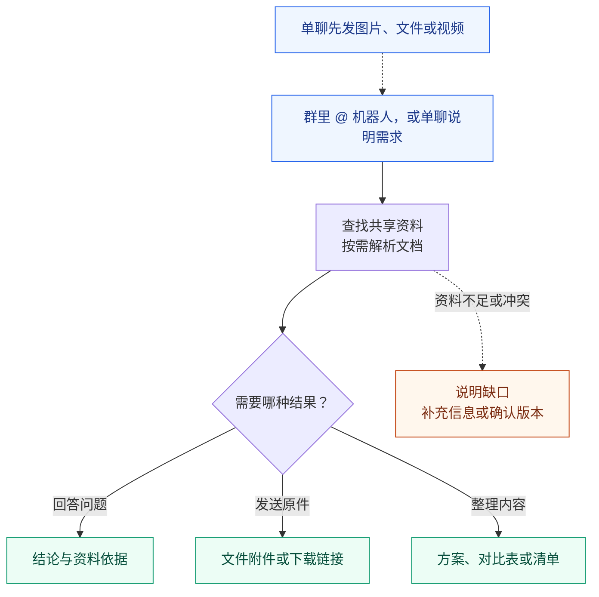

# mixin-chatbot

中国电信量子密信开发者平台的应用机器人协作 Agent。

在群里 **@ 机器人**，或在机器人应用里**直接单聊**，说明需求即可。机器人会查找资料、调用工具，把回答或生成的文件发回原来的群或单聊。

默认提供产品资料助手提示词和文档加工 skill：查询产品、发送原件、修改 Word、选编 PPT、按模板生成方案和制作对比表，适用于售前、交付及售后的文档工作。修改 [prompt.ts](src/agent/prompt.ts) 可调整用途，文档能力见[开发指南](docs/development.md#文档加工)。

机器人以开放平台**应用机器人**接入，经事件 Stream 主动连出接收消息，服务器不需要公网入口。

> **⚠️ 注意：从 v1.0.0 开始，本项目改为应用机器人。** 此前发布的 webhook 版本（legacy，没有版本号）**不能升级**到本版本：请在新目录全新部署，旧会话、资料目录和配置都不迁移；旧统计的提问数和 token 用量可用一次性工具导入新账本。步骤见[从旧版 webhook 发布切换](docs/data-migrations.md#从旧版-webhook-发布切换)。

[群聊与单聊](#群聊与单聊) · [快速开始](#快速开始) · [使用](#使用) · [日常管理](#日常管理) · [详细文档](#详细文档)

## 可以做什么

| 需求 | 可以这样问 |
| --- | --- |
| 查资料 | “X 产品支持哪些部署方式？请注明资料来源。” |
| 拿原件 | “把 X 产品当前正式版的手册原文件发给我。” |
| 做对比 | “对比 X 和 Y 的功能、部署方式及限制，生成 Excel 表。” |
| 整理方案 | “根据资料整理项目 A 的方案，生成 Word 文件，列出待确认项。” |
| 修改底稿 | “按最新产品资料更新这份交付方案的部署条件，保留原版式。” |
| 选编 PPT | “从已有产品 PPT 中挑页、修改客户名称并补充部署建议，组装客户方案。” |
| 处理自己的文件（单聊） | 先发文件或截图，再说“总结这份文件，列出与产品资料不一致的地方。” |



## 群聊与单聊

两种会话共用同一份资料目录和同一套指令，区别在于怎么提问、能发什么：

| | 群聊 | 单聊 |
| --- | --- | --- |
| 怎么提问 | 必须 @ 机器人（指令也要 @），否则机器人收不到 | 直接发送 |
| 能发给机器人的内容 | **只支持文字**（含引用回复）；发图片、文件或视频会提示改到单聊发送 | 文字（含引用回复）、**图片、文件和视频** |
| 机器人发回的内容 | 文字回答，以及生成或查到的文件 | 同群聊 |
| 回复格式 | 开头一行“> 回复 姓名：提问摘要”，最终结果会 @ 提问人 | 直接回复 |
| 会话 | 每人在每个群里各有一个独立会话 | 每人一个独立会话 |

- 会话按空间隔离：全部单聊共用一个空间，每个群一个空间；每位成员在各空间中有独立的会话和临时文件，`/clear` 只影响自己在当前群或单聊的对话。
- 机器人按通讯录识别成员（以手机号归属会话和统计）。刚部署或刚加入通讯录时可能提示“正在同步通讯录”，稍后重发即可。
- 语音等其他消息类型暂不支持。

## 快速开始

### 1. 准备环境

选择与服务器对应的部署方式：

| 部署方式 | 需要准备 |
| --- | --- |
| Windows 原生 | Bun 1.4.4+、Git for Windows（含 GNU Bash）、原生 `uv.exe`；使用管理员 PowerShell |
| Linux / Docker | glibc Linux、Git、Docker Engine、Bash、curl、coreutils、util-linux 的 `flock`；rootful Docker 由 root 部署和升级（docker 组普通用户会被拒绝），rootless Docker 由其所属用户部署 |

Docker 镜像已包含应用运行环境和文档解析依赖，宿主机无需安装 Bun；使用终端管理台时，宿主机另需 Bun 1.4.4+。Linux 需要可访问 `/proc`，不支持 macOS、Alpine/musl。安装链接见[选择部署方式](docs/deployment.md#选择部署方式)。

同时准备：

- **模型账号**：API Key 和要使用的模型；自定义接口还需接口地址和协议。
- **应用机器人**：在量子密信开发者后台创建企业自建应用、启用机器人能力，记下 AppID 和 AppSecret，并授予收发消息、临时文件和通讯录读取权限（最小权限见[应用机器人](docs/deployment.md#应用机器人)）。通讯录可见范围要覆盖所有会使用机器人的成员。
- **出站网络**：服务器能以 HTTPS（443 端口）访问 `imtwo.zdxlz.com` 和 `imfl.zdxlz.com`。不需要开放入站端口、域名或隧道。

### 2. 获取代码并部署

```sh
git clone https://github.com/jaykwok/mixin-chatbot.git
cd mixin-chatbot
```

请在**新的空目录**部署，不要在旧版 webhook 部署的目录上部署。运行对应平台的部署脚本，按向导填写 AppID 和 AppSecret、选择模型并填写凭据：

**Windows**（管理员 PowerShell）：

```powershell
powershell -NoProfile -ExecutionPolicy Bypass -File scripts/deploy/deploy.ps1
```

**Linux / Docker**：

```sh
bash scripts/deploy/deploy.sh
```

rootful Docker（默认安装）下用 root 运行（`sudo bash scripts/deploy/deploy.sh`），rootless Docker 下用其所属用户运行。脚本会准备依赖、保存配置并启动服务；凭据和模型配置由向导生成，通常无需手写 JSON。

- 共享资料默认放在 `data/workspace/`；部署时可用 `WORKSPACE_ROOT` 指向已有的外置目录，服务只读。
- 本机管理端口自动使用 `1011`，不需要填写；大文件外链可稍后配置。
- 各项配置说明见[部署与配置](docs/deployment.md)。

### 3. 接入开发者后台并验证

1. 服务启动后，在开发者后台的事件订阅中选择 **Stream**，点「验证连接」（服务必须已在运行），勾选机器人接收消息事件并保存。步骤见[接入开发者后台](docs/deployment.md#接入开发者后台)。
2. 运行 `doctor`，检查配置、服务、事件 Stream 和通讯录同步。首次通讯录同步在后台进行，完成前未同步到的成员会收到“正在同步通讯录”的提示。

   **Windows**：

   ```powershell
   powershell -NoProfile -ExecutionPolicy Bypass -File scripts/ops/ops.ps1 doctor
   ```

   **Linux / Docker**：

   ```sh
   bash scripts/ops/ops.sh doctor
   ```

3. **验证群聊**：在客户端把应用机器人加入测试群，@ 机器人发送“只回复 OK”，确认能收到回答。
4. **验证单聊**：在机器人应用里发一条消息，再发一张图片或一个文件，确认机器人回复“已收到…”。
5. 把资料同步到共享资料目录，再请求查找资料、发送文件，并试一下 `/status`、`/stop`。目录结构与备份见[数据目录](docs/deployment.md#数据目录)。

本地健康检查只表示应用已就绪；在群里和单聊里都收到回复和文件，才算完成实际验证。遇到问题先看[运维手册](docs/operations.md)。

## 使用

说明产品或项目名称、版本要求和输出格式即可。同一用户的请求按顺序处理，最多 8 条排队，等待时可以查询进度或取消。

| 指令 | 用途 |
| --- | --- |
| `/status` | 查看当前进度、排队情况和正在运行的工具 |
| `/stop` | 取消当前任务并清空等待消息 |
| `/clear` | 取消任务，在当前群或单聊开始新会话（旧会话留在空间库里） |
| `/compact` | 为本人在当前群或单聊生成上下文摘要，保留历史记录；会产生模型用量 |
| `/help` | 查看指令说明 |

### 发文件给机器人（仅单聊）

在单聊中把图片、文件或视频发给机器人，它会回复“已收到…，请说明要怎么处理”并在后台下载；接着发一条文字说明要做什么。这条请求会带上之前收到、还没用过的全部附件。

- 项目不限制收取的文件大小，以平台和服务器磁盘为准；下载失败时会说明原因。
- 每人最多保留 10 个还没用过的附件，24 小时内没有被请求用到的会作废。
- 模型支持图像时，机器人可以直接查看图片。
- 群聊里不能发文件给机器人；需要处理自己的文件时请改用单聊。

### 机器人发回的文件（群聊和单聊）

- 不超过 **30 MiB** 的文件直接作为附件发送。
- 更大的文件需要管理员[配置外链](docs/operations.md#配置可选的大文件外链)（可选），以下载链接发送，默认分发上限 **2 GiB**，链接默认 2 小时有效。
- 回复或文件被平台拒收时，机器人会自动重发，6 小时内仍发不出才放弃；发送结果不确定（平台可能已收到）的内容不重发，以免重复。

服务重启或升级期间发出的消息，平台约 5 分钟后补推，机器人照常处理；停机超过 5 分钟时，期间的消息可能收不到，需要重发。完整行为见[使用指南](docs/usage.md)。

## 日常管理

在项目目录启动终端管理台（TUI）：

```sh
bun run tui
```

用 **`←` `→` 切换分区**，`Tab` 切换子页，**空格打开操作菜单**。推荐终端尺寸为 100×24 或更大。


*由实际 TUI 渲染生成，使用演示数据，示例尺寸为 100×24。*

| 想做什么 | 在哪里操作 |
| --- | --- |
| 检查故障、查看日志 | 监控 → 体检 / 日志 |
| 查看用量、导出离线 HTML 报表 | 统计；`w` 选日期范围，`e` 导出，`o` 打开 |
| 查看会话、清理临时文件和外链 | 数据 → 会话 / 临时文件 / 外链 |
| 清空会话，相当于全员发送 `/clear`（不影响使用统计） | 数据 → 会话：`c` 当前空间，`a` 全部 |
| 启停、升级或重新部署 | 系统 → 服务部署 |
| 查看 Stream 与通讯录同步、确认暂停的撤销 | 系统 → 通讯录 |
| 修改应用机器人凭据、外链和运行参数 | 系统 → 设置 |

总览显示正在运行的版本、构建和数据格式；本地代码与运行中的服务版本不同时另行注明。键位与报表预览见[管理台与报表](docs/tui.md)。

不用管理台时，把上面 `doctor` 命令里的 `doctor` 换成 `start`、`stop`、`restart`、`logs` 或 `update`，TUI 与命令行升级共用同一流程。升级条件与备份清理规则见[命令行运维](docs/operations.md#命令行运维)。

### 版本与升级

版本分三项：程序版本（当前 1.0.1）、数据格式（当前 1）和构建（Git 提交）。部署记录 `data/state/data-version.json` 写明实际部署的版本，并绑定部署时的应用；升级按它判断，数据格式一致才升级，没有有效记录的目录拒绝原地安装或升级。规则见[版本、数据格式与从旧版切换](docs/data-migrations.md)。

## 详细文档

| 文档 | 适合什么时候看 |
| --- | --- |
| [部署与配置](docs/deployment.md) | 安装部署、选择模型、查配置项、同步资料和备份数据 |
| [使用指南](docs/usage.md) | 群聊与单聊的提问方式、指令、发文件给机器人和文件交付 |
| [管理台与报表](docs/tui.md) | 查键位、设置入口、清理操作和报表导出 |
| [运维手册](docs/operations.md) | 命令行管理、排查故障、通讯录同步、配置外链 |
| [版本与从旧版切换](docs/data-migrations.md) | 版本、数据格式与应用绑定规则，以后的升级边界，从旧版 webhook 发布切换 |
| [开发指南](docs/development.md) | 理解架构、修改提示词与工具、了解文档加工能力、运行开发检查 |

基于 Bun、Hono 和 Pi（Durable 引擎，全部单聊一个、每个群一个 SQLite 空间库）。项目面向可信内部成员：`bash` 工具拥有运行账户的系统权限，详细边界见[提示词与工具](docs/development.md#提示词与工具)。
