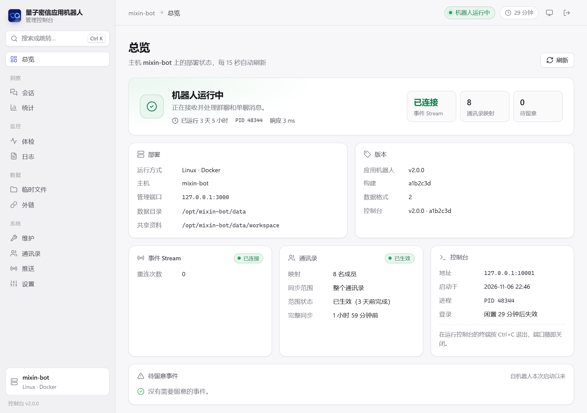
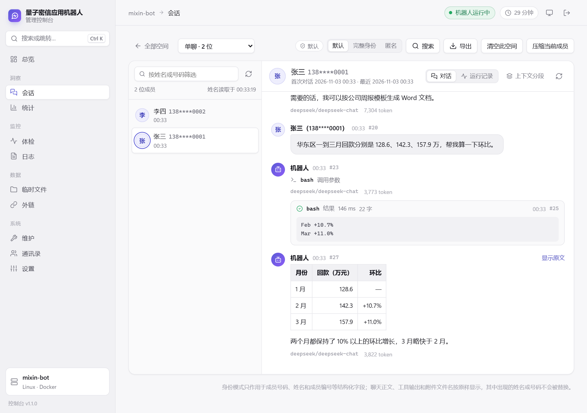
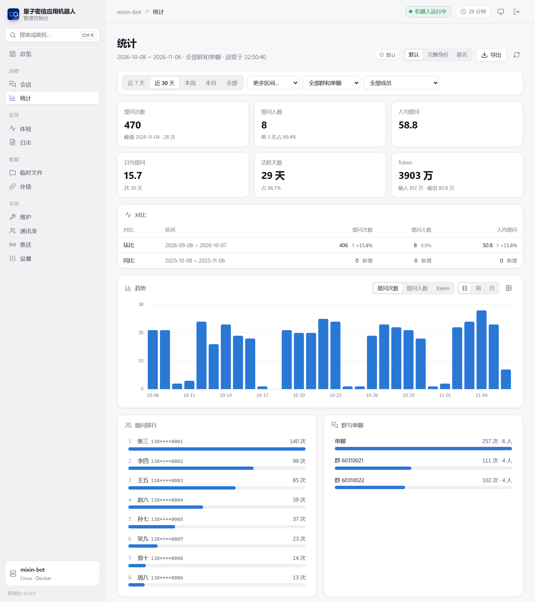
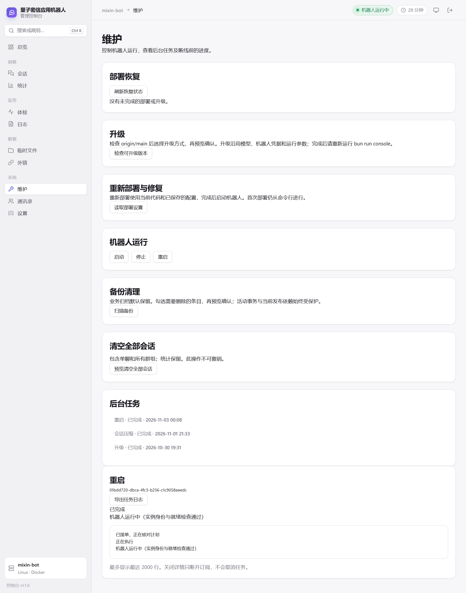

# 网页控制台

[返回 README](../README.md) · [部署](deployment.md) · [命令行运维](operations.md)

控制台在部署机器上单独运行，机器人停止时仍可使用。需要管理时启动，用完退出；首次部署和卸载仍使用命令行。Windows 和 Linux 共用网页界面；管理动作经对应平台的运维入口交给与命令行共用的运维核心，规则与命令行一致。

## 启动与登录

在项目目录运行：

```sh
bun run console
```

宿主机需要 Bun 1.4.4+。Windows 自动打开默认浏览器；Linux 打印 SSH 转发命令和登录链接。控制台只监听 `127.0.0.1`，初始端口为 `11012`，成功启动后保存在 `.console/port`，后续沿用。

| 环境 | 管理操作使用的身份 | 后台任务 |
| --- | --- | --- |
| Windows 原生部署 | 管理员终端中的部署身份 | 一次性计划任务 |
| Linux rootful Docker | root，与命令行运维相同 | systemd 临时服务 |
| Linux rootless Docker | 拥有该 Docker daemon 的部署用户 | 用户级 systemd 临时服务，需要 linger |

rootless 使用该用户自己的 `DOCKER_HOST`、`XDG_RUNTIME_DIR` 和登录会话；后台任务沿用启动控制台时的 `DOCKER_HOST`、`DOCKER_CONTEXT` 和 `DOCKER_CONFIG`，与预览连接同一个 Docker daemon。控制台不会自动切换用户、启用 linger 或安装系统服务。后台托管条件不满足时，页面说明原因并拒绝后台写操作。

常用参数：

```sh
bun run console --port 12012
bun run console --no-open
bun run console --help
```

端口占用时直接报错，不自动改用其他端口。控制台也不会占用机器人保存的端口或未完成事务需要的端口，即使机器人当时已停止。

登录链接五分钟内有效，只能使用一次。需要新链接时，在运行控制台的终端按 Enter；此前未使用的链接随即失效。登录后闲置三十分钟或满八小时，需要重新登录。退出登录会清除当前页面中的会话内容。

在终端按 Ctrl+C 退出控制台后，网页入口关闭。已经由后台执行器接单的管理任务继续执行；会话查询和导出随控制台退出而停止。

### 通过 SSH 访问

在服务器启动控制台，在自己的电脑建立转发，再在电脑的浏览器打开终端打印的登录链接。例如：

```sh
ssh -N -L 11012:127.0.0.1:11012 user@server
```

可以将转发写入 SSH 配置。电脑上的本地端口需要不同时，在服务器显式指定该端口：

```sh
# 服务器
bun run console --forwarded-port 12012

# 自己的电脑
ssh -N -L 12012:127.0.0.1:11012 user@server
```

使用输出中的 `127.0.0.1` 地址和端口，不将页面发布到公网。控制台检查 Host、请求来源和登录 cookie；同一主机其他端口的网页也不能代发管理请求。

## 页面与数据

| 页面 | 用途 |
| --- | --- |
| 总览 | 部署、运行状态、版本和待处理事项 |
| 会话 | 单聊与群聊的成员、历史消息、工具和交付详情；清空、压缩和导出 |
| 统计 | 日期、空间与成员筛选、提问与用量、趋势；HTML/CSV 导出及统计导入 |
| 体检、日志 | 环境检查；关键词、级别与任务编号筛选，导出筛选结果 |
| 临时文件、外链 | 明细、归档与回收；外链测试及清理 |
| 维护 | 服务启停重启、升级和恢复、重新部署/修复、备份清理、后台任务记录 |
| 通讯录 | 同步状态和部门范围选择 |
| 推送 | 推送记录、补推送、抄送和汇总包；推送人、管理员和授权；群名单 |
| 设置 | 模型、机器人凭据、外链、运行参数；辅助模型和 MCP 状态 |



会话正文和通讯录姓名需要机器人运行时通过只读接口读取。机器人停止后，统计仍可读取和导出，但姓名不可用，页面和导出会标明原因。姓名来自读取时的通讯录，并非对话发生时的历史姓名。群按推送登记的群名显示（“群 销售一部”），没有登记或机器人停止时显示群号。



会话可以搜索文字，不区分大小写：

- 空间列表上方的搜索框查找全部单聊和群聊，先查单聊，再按最近活动依次查各群。结果注明所在空间，点击即按搜索时的身份模式打开那个空间，并跳到那位成员的那条记录。全部空间搜索只提供默认和匿名两种身份模式；需要完整号码时，打开空间后再切换。搜索期间被更换或删除的空间会跳过并注明原因。
- 打开空间后，「搜索」在当前空间或当前选中的成员中查找。
- 多个词用空格分开，须同时出现在同一条记录中；英文双引号括起的词组按整体查找。
- 可以只搜提问、回答、思考、工具（参数和输出）、压缩摘要或推送备注中的几类，不选即全部；系统提示不搜索。
- 可以限定时间：今天、最近 7 天、最近 30 天或自定义日期，日期按浏览器所在时区计算。
- 已有结果时，改内容类型、时间、搜索范围或身份模式会按新条件重新搜索。

结果从最新的记录往前列出，带前后文片段并标出各个词。每次读取有限条数，可以继续搜索更早的记录。审计只记录搜索的范围和身份模式，不记录搜索内容。

体检发现问题时仍显示完整检查结果及处理建议；只有查询本身失败、超时或报告不完整时才显示读取错误。体检不会自动修复或修改配置。

统计的成员名单来自已查看的范围；找不到成员时，可先调整时间或选择所在空间。成员筛选同时作用于合计、趋势、模型和工具用量、历史对比及导出。切换身份模式会清除成员选择，需要从新名单重新选择。



### 身份模式与导出

默认显示通讯录姓名和打码号码；完整身份模式需要当次确认；匿名模式只显示本次编号。选择只对当次页面或导出有效，不修改默认模式。匿名导出的编号每次重新分配。

这些规则针对结构化身份字段。消息正文中原本写有的姓名和号码会保留，匿名模式不对正文进行匿名化。

- 会话可按成员或整个空间导出 JSON、Markdown。
- 统计可导出独立 HTML 报表或 CSV。HTML 可离线打开，不需要外部资源。
- 日志页可下载筛选结果；维护页可按任务编号下载执行记录。

含姓名的导出在文件名和开头标注“含个人信息”。导出直接传给浏览器，服务器不保留聊天正文导出文件，也不将其纳入备份。下载取消、会话失效或控制台退出后，需要重新导出。导出中的读取时间、截点及可变交付状态说明用于区分当时的记录与后续变化。

统计导入支持宿主机文件路径或上传一致的 SQLite 快照；有 WAL 时须同时保留对应文件，不能在数据库仍写入时随意复制一个主文件。预览确认后停机导入并恢复原状态。同版本统计可恢复到空账本，旧版统计规则见[统计迁移](data-migrations.md)。会话清空和压缩不会删除已入账统计。

### 推送

推送页的数据都经机器人读写，机器人没有运行时只提示。推送的用法见[使用指南](usage.md#推送)。

- **推送设置**：读取名单后添加成员（输入完整手机号）、勾选推送人和管理员，按人设置 24 小时内最多推送几条（留空为不限），并授权推送给全员、推送到已登记的群、按部门推送（不能、任意部门或指定部门，指定部门含下级）。默认只能推送给个人。保存时机器人核对每个人都在同步的通讯录里，保存后立即生效。名单为空时推送功能关闭；既不是推送人也不是管理员的人保存时移出名单。
- **推送记录**：列表上方是总计：已发出的推送条数，已结束推送的确认率（送达的人或群里确认收到、做了选择或开始回复的比例）和回复率（需要回复的推送里已回复的比例）；删除的推送不再计入。列表按状态筛选（进行中、已结束、待确认、未发出）。打开一条推送可以看每个接收人的发送、确认、选择和回复，按“未答复”“发送失败”“回复中”筛选；给没有答复的人（全部或选中的）重发卡片，已结束的推送改为生成补推送预览，由推送人确认；在汇总发出前修改抄送人；下载整条推送或某个接收人的汇总包；删除已结束的推送（会话里的推送记录保留）。
- **群名单**：机器人在群里被 @ 过的群都列在这里，显示状态、最近被 @ 的时间、登记时间和登记人。可以填群名登记、改名、停用和重新启用；停用的群不能再推送，已发出的推送照常收集答复。

推送页和其他页面一样只显示姓名和打码号码，不提供完整身份模式。打开推送（能看到回复内容）、补推送、修改抄送、删除、下载、保存推送设置和修改群名单都记入审计，只记推送编号、人数和群号。汇总包下载与导出相同：浏览器凭一次性链接直接下载，文件不在控制台主机保留。

## 管理任务与恢复

管理操作先预览范围及恢复规则，再确认执行。确认后的计划绑定部署身份、代码版本、运行状态和相关配置；这些事实变化后需要重新预览。后台任务保存独立的接单、进度和结果记录，关闭网页、控制台或 SSH 不会撤销已经接单的操作。

重新运行 `bun run console` 并登录后，在维护页查看任务。中断或未知状态不等于成功；有未完成事务时，按页面给出的继续、回滚或恢复入口处理。部署数据已经提交时只允许继续收尾，不能回滚。



升级先显式检查远端，再预览固定目标提交。重新部署使用当前代码，并明确选择机器人端口和共享资料目录。Linux 修复通过重新部署完成；Windows 本机修复先核对实例，已就绪时不重启，未就绪（包括已停止）时重启并核对就绪；前台运行的实例不修复，计划任务缺失或损坏时改用重新部署。

升级或回滚改变代码后，旧控制台继续显示任务结果，拒绝新的查询、导出和管理操作。任务完成后在终端退出，再运行 `bun run console`，用新登录链接打开新版。控制台不会自动重启或移交旧登录。

### 配置与通讯录

模型、机器人凭据和外链配置采用“编辑草稿 → 校验 → 预览确认 → 应用”。已保存的秘密不回显；沿用或替换由表单明确选择。取消草稿不改正式配置。应用在维护窗口内完成，失败时按事务恢复；恢复失败会保留材料并阻止不安全的启动。

通讯录页的部门选择从一级部门开始逐层展开，可以在不同分支、不同层级各选一些部门，每个部门含其全部子部门：已选部门之下的子部门标为“已包含在「上级」中”，不能单独勾选；勾选上级时，原先单独勾选的下级并入其中。最多选 200 个部门，超出时改选它们的上级部门。整个通讯录是单独的选择。选择期间不限时；“重新读取部门树”从平台重新读取，保留尚未保存的勾选。同步范围按部门路径显示（如“1 个部门及其子部门：公司/技术部”）。

运行中的通讯录范围选择保存后立即生效：先核对部门，完整同步成功后切换名单。保存后页面跟踪应用进度，完成或失败时说明结果并刷新上方的同步状态。没有暂停确认或撤销确认按钮；失败时保留之前的名单并显示重试状态。首次部署或缺少范围的升级/重部署，必须明确选整个通讯录或逐层选择部门，所选范围随部署事务安装；取消选择不写配置。

## 本机文件与排查

`.console/` 保存端口、私有配置草稿、预览生成的操作计划、固定运行包、任务与审计记录。操作计划过期一小时后删除。固定运行包在启动控制台时清理：所有任务都已结束、没有未完成的部署、升级或维护时，删除当前版本以外、7 天内没有用过的版本。Linux 检查属主与权限，Windows 检查属主与私有 ACL；使用与部署一致的身份启动，不通过放宽目录权限来绕过报错。Windows 上继承项目目录权限的 `.console/`（例如手工创建或从别处复制的）会被拒绝，控制台不会自己改动它。处理办法有两种：一是确认没有未完成的管理任务后，把整个目录移出项目目录再启动（控制台新建私有目录，端口和审计记录随旧目录移走）；二是按报错给出的 `icacls` 命令把它收紧为仅当前账户、Administrators 和 SYSTEM，再启动。审计记录查看、导出和管理动作，不复制会话正文。

管理任务的日志与最终状态以页面和对应运维记录为准。排查时保留任务编号和错误说明；有未完成事务时先使用恢复入口，不删除 `.console/` 或事务文件来消除提示。命令行和 CI 可继续直接使用 [ops.sh / ops.ps1](operations.md#命令行运维)。
