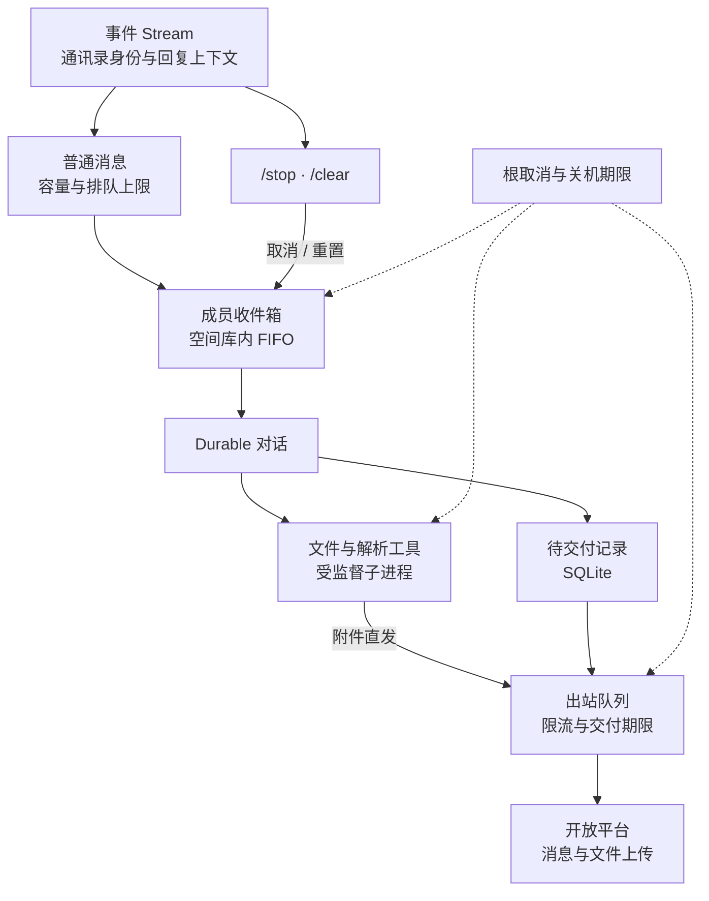

# 开发指南

[返回 README](../README.md) · [部署与配置](deployment.md) · [运维手册](operations.md)

**本页内容**：[工作原理](#工作原理) · [提示词与工具](#提示词与工具) · [资料解析](#资料索引与文档解析) · [文档加工](#文档加工) · [缓存与用量统计](#缓存与用量统计) · [开发与检查](#开发与检查) · [数据版本与升级](#数据版本与升级)

只调整机器人的用途时，从 [prompt.ts](../src/agent/prompt.ts) 开始。修改代码后，按[开发与检查](#开发与检查)验证。

## 工作原理

基于 **Bun + Hono + Pi Durable 1.4.0 引擎**，支持 Windows 原生部署和 Linux / Docker。消息经量子密信开放平台的应用机器人事件 Stream 进入，回复和文件经开放平台接口发出。每个空间（一个群，或所有单聊共用的 `direct`）一个 Durable 数据库（`<空间目录>/durable.sqlite`），空间内每位成员一个对话。下面是任务处理与取消、交付之间的关系：



Stream 回调里同步完成字段校验、会话识别、身份查询（`agent.sqlite` 中的通讯录映射）和回复上下文，再交给消息服务，因此同一成员的消息按事件到达顺序入队。普通消息写入该成员的收件箱（空间库内的一次提交，同一事务写消息回执），平台重复推送同一条消息时按回执只处理一次；服务重启后从收件箱和未结束的运行继续。平台对离线期间的消息约 5 分钟后补推一次，补推到达的控制命令不执行。一轮任务覆盖准备、模型执行、工具调用和最终交付。同一空间、同一用户按 FIFO 串行处理，每人最多排队 8 条，不同用户可以并发；默认全局最多同时运行 32 个普通请求。

停止与清理走独立控制路径，不受普通消息容量和排队上限阻挡；控制命令记入空间库的控制流，执行完才移除，中途停机的会在下次启动时重新执行。图中虚线表示根级取消约束：关机先广播取消，进程和出站请求在统一期限内收尾。

回复上下文（目标会话、提问人、摘要）随运行记录持久保存，重启后的回复仍发回原来的群或单聊。群消息一律以 Markdown 发送：回复和通知的第一段开头是“> 回复 姓名：提问摘要”，最终回复和终止性错误的第一段同时 @ 提问人；后续分段不带摘要和 @，在同一发送顺序内连续发出，中间不夹其他消息。单聊直接回复。最终文本和必要外链先持久化，平台确认后才移除记录；只有明确的业务拒绝（`success:false` 或非成功的数字 `code`）算未发出，超时、连接重置、网关超时以及空、无法解析或既不确认也不拒绝的成功响应都算结果不确定，这类内容视为已发、不再重发（平台不按幂等键去重）。明确未发出的部分按 1、5、15、30 分钟、之后每小时退避自动重试，重启后接着重试；从生成起 6 小时（兜底计划以其发送预算为准）仍未发出就放弃并写日志，外链过期、快照缺失或摘要不符这类重发解决不了的失败立即终止。`/stop`、`/clear` 撤回成员之前未发完的计划。每条外链说明是单独的一条消息，各自记录送达状态，重试时跳过已确认的部分。文件附件由发送工具直接交付：不超过 30 MiB 的文件经分片上传（合并时提交真实 MD5）后以文件消息发送，更大的文件走可选外链。单聊收到的图片、文件和视频流式下载到成员 tmp，由下一条文字请求带入，项目不限制入站大小。

## 提示词与工具

基础系统提示词在 [prompt.ts](../src/agent/prompt.ts) 中维护，由 Durable 扩展 [durable/prompt.ts](../src/durable/prompt.ts) 组装成系统提示词（与 Pi 的 `systemPromptOverride` 相同的段落）。不自动发现 extensions、skills、prompt templates、themes 和上下文文件，也不读取群工作区的 `.pi/settings.json`。[模块注册入口](../src/agent/modules.ts) 按开关一起提供工具、skill、提示词补充和只读资源目录；文档加工模块见[下文](#文档加工)。共享资料中的 skill 不能改变指令或运行设置。

回答以共享资料为依据，尽可能标明文件、页码或 sheet。资料内容作为证据处理，原始资料按用户要求直接发送。

| 工具 | 用途与边界 |
| --- | --- |
| `read` | 读取共享资料、资料索引、本用户 tmp 及项目文档 skill |
| `edit` / `write` | 仅写本用户 tmp，检查规范路径 |
| `bash` | 执行命令，统一管理超时、取消、输出上限及后代回收 |
| `document_environment` | 按需准备解析环境，验证实际解释器、版本和库导入 |
| `document_extract` | 提取 PDF/DOCX/PPTX/XLSX，按内容与解析器版本复用缓存，返回可检索的文本路径 |
| `document_inspect` | 检查 DOCX/PPTX 包及内部引用，返回段落位置、正文块、实际页序和内容摘要；可附带页面或章节大纲 |
| `document_patch` | 按摘要与精确位置修改副本中的文字，保留未修改的文档部件 |
| `document_compose` | 选编 Word 正文块或 PPT 页面，可混合 Markdown 新内容，生成新文件与来源记录 |
| `document_build` | 用 Markdown 在模板的母版、版式与样式上整份生成 Word 或 PPT |
| `document_images` | 从 PDF/PPTX/DOCX 提取内嵌图片或按区域截取渲染页，作为 Markdown 图片素材 |
| `document_render` | 将 DOCX/PPTX/PDF 渲染为逐页图片及联系表；Office 需要 LibreOffice |
| `send_file` / `send_image` | 发送文件或图片；本地路径复用文件工具的解析规则 |
| `codemode` | 在沙箱里运行模型写的 JavaScript，并行或按依赖顺序调用其他工具，只把筛选后的结果交给模型 |

基础四工具由 `@earendil-works/pi-durable/tools` 原生注册；每次调用从持久身份解析成员并创建独立的 `ExecutionEnv`（`src/durable/member-env.ts`），不共享可变 cwd。`read` 使用 bounded BinaryReader 和官方 Photon 图片处理；bash 的结构化结果使用 `exitCode` / `fullOutputPath`，诊断由 Durable 统一呈现。

每个对话都接入 codemode：沿用 Pi 官方 codemode 的脚本运行时和说明文字（[durable/codemode](../src/durable/codemode)，宿主职责集中在 `index.ts`，非公开文档/结果形状依赖集中在 `protocol.ts`），不向脚本开放模型目录。六个 `document_*` 加工工具只能在脚本里调用：不直接声明给模型，列在 codemode 的说明里，用法说明由脚本里的 `describeNamespace("document_work")` 取得。`send_file` / `send_image` 只给模型直接调用，脚本拿不到；其余工具两种方式都能调用。原生 `read` 没有结构化输出 schema，官方 Codemode 只返回其文本，图片块在脚本值中省略；需要模型查看图片时直接调用 `read`。脚本里的调用走同一套工具包装、路径边界和文档并发上限（解析与加工各同时 2 个）。脚本输出过长时，完整输出和超长的子调用结果直接写在本用户 tmp 的 `codemode/<任务>-<调用>/` 下，只有本人的 `read` 能打开，不经过共享的系统临时目录。

Codemode 的进程级预算为 2，单聊和所有群（全服务）共享同步 `acquireWorker()`。满额明确拒绝；构造失败或真实 worker exit 才释放。result、取消或 `close()` 完成不能当成线程退出。关机先停止准入，等待实际退出仍受整个应用的统一关机期限约束。

Windows 用 Job Object 管理工具进程及后代，Linux 用 subreaper 和父进程死亡通知回收后代；主命令退出、超时、取消或机器人父进程强制结束都会触发收尾。输出总量限制为 16 MiB，并保留错误尾部。

上面的进程监督只负责回收进程，不限制文件访问。文件边界按平台不同：

- **Linux Docker**：bash、文档处理与解析在独立 rootless 任务 daemon 的一次性容器里运行，使用 `--network none`；共享资料、资料索引和显式列出的输入只读可见，只有该任务自己的工作目录可写，见[任务隔离部署](deployment.md#任务隔离部署)。服务容器本身非 root、只读镜像并移除 capabilities，外置资料目录只读挂载。
- **Windows 原生部署**：bash 不隔离，保有服务运行账户的操作系统权限，能读写该账户可访问的文件，工具说明里也不出现隔离参数。

MCP stdio 程序在两个平台上都具有服务用户权限。当前部署面向可信内部成员；不可信用户需要独立的 OS 隔离方案。

### 资料索引与文档解析

索引用于定位文件，未命中时仍需定向查找资料。`data/config/materials-ignore.txt` 在首次建立索引时生成只含注释的用法模板，之后不再覆盖；每行一个共享资料相对路径前缀，`**/名称` 匹配任意层级，`#` 表示注释。它只影响索引，不限制模型直接查找文件。扫描受文件数和深度限制，无法读取的目录会使清单标记为不完整。

PDF、DOCX、PPTX、XLSX 文本优先使用 `document_extract`，它会按需检查解析环境，并按原件 SHA-256、解析器与依赖锁版本复用缓存：共享资料的结果位于 `data/index/parsed`，用户私有文件的结果只放本用户 tmp。特殊解析或文件生成先调用 `document_environment`；模型不能自行安装包或改写共享环境。不提供 OCR，文档工具只接受现代 Office 格式。

Python 依赖由 [pyproject.toml](../pyproject.toml) 和 [uv.lock](../uv.lock) 管理，[.python-version](../.python-version) 选择 3.14 系列，默认使用应用共享的 `data/runtime/document-env`。Docker 构建、原生准备和就绪检测共用 [document-manifest.ts](../scripts/runtime/document-manifest.ts)。修改依赖后运行 `uv lock`，再做[文档回归](#文档回归)。

## 文档加工

文档加工是默认开启的可选模块，覆盖修改 Word、选编和修改 PPT、整合资料或按模板生成新文档。原件提供可复用内容，正式资料提供事实，模板提供样式；内容取舍和版面由模型决定，工具负责把容易写错的文件操作做可靠。

| 层次 | 负责什么 | 入口 |
| --- | --- | --- |
| Skill | 复用原则、工具选择和交付标准 | [SKILL.md](../src/agent/modules/document-work/skills/document-work/SKILL.md) |
| 按需指南 | Word/PPT 编辑要点、Markdown 生成约定、流程图脚本和各类文档的内容要点 | [references](../src/agent/modules/document-work/skills/document-work/references) |
| 工具 | 摘要校验、大纲、局改、组装、按模板生成、图片素材、渲染、来源记录 | [tools.ts](../src/agent/modules/document-work/tools.ts) |
| 固定环境 | 共享环境按需 `uv sync`，统一 Python 与依赖锁 | [python-toolchain.ts](../src/agent/python-toolchain.ts) |

**开关。** `BOT_DOCUMENT_WORK_ENABLED` 默认 `1`，设为 `0` 关闭：在 TUI 的「设置 → 高级运行参数 → 文档与诊断 → 文档加工模块」修改并应用，或在 `data/config/runtime.json` 中设置后重启；进程环境变量优先于文件。关闭会移除六个文档工具（codemode 脚本也调用不到）、skill、模块提示词及其额外 `read` 权限；资料索引、`document_extract`、`document_environment`、原文件发送和 `read/bash/edit/write` 保留，已有 venv 不卸载。

实现集中在 [document-work 模块目录](../src/agent/modules/document-work)，[modules.ts](../src/agent/modules.ts) 是唯一注册点。要从代码中移除，先关闭并重启，再删除模块目录和对应的注册分支，清理相关测试和专用依赖（`pptx-automizer`、`docxcompose`、`pypdfium2`），重新生成锁文件并运行 `bun run check`。

所有来源先复制到本用户 tmp 中再处理，原资料不被覆盖；修改、组装与生成同时输出来源路径、摘要和选编信息。每次调用的中间文件在结束时删除，成功保留成品、预览图片和报告。

### 能力边界

| 情形 | 当前行为 |
| --- | --- |
| Word 组装 | 第一份提供主样式与页眉页脚，后续来源的页眉页脚不导入；正文块范围包含边界 |
| PPT 尺寸不同 | 拒绝直接组装，先按目标尺寸重排所需内容 |
| 文字改长 | 局改保留原容器，不自动放大文本框；需要渲染后检查溢出 |
| 模板推断 | PPT 标题样式取自模板样例页；模板没有内容页或版式差异大时用 `styleFrom` 指定样例页。行数按字宽估算，最终以渲染图为准 |
| 自动图示 | 卡片、流程、分层、时间轴、指标、循环、金字塔只识别短段落和明确的标签模式，装不下时退回普通版式并提示；颜色取模板标题色或主题强调色 |
| Mermaid 流程图 | 子集：节点形状、带标签的连线、虚线与粗线、`&` 汇合；subgraph、style、click 忽略并提示；最多 40 个节点、80 条连线。Word/PNG 需要中文字体，无字体时保留源码 |
| 图片素材 | 只提取位图；EMF/WMF/SVG 和组合图示需用 `crops` 从渲染页截取 |
| 域、修订记录 | 局改工具拒绝受影响段落，需要专门脚本处理副本 |
| 复杂 PPT 对象 | 动画、SmartArt、媒体、外部链接及复杂图形需实际核对，不承诺全部无损 |
| 外部关联 | 检查器提示关联数量，不访问其内容；结构检查不等同于完整 Office 校验或文件脱敏 |
| 预览 | 默认前 20 页，单次最多 50 页。Office 预览依赖 LibreOffice，最终字体和分页以客户软件为准 |

单来源最大 128 MiB，一次来源总量和 Office 解压总量各最大 256 MiB；组装最多 20 个来源、PPT 最多 200 页。文档操作全局并发 2，单次总期限 5 分钟，受任务取消与进程监督约束。

### 参考项目与许可

| 项目 | 用法 |
| --- | --- |
| [pptx-automizer](https://github.com/singerla/pptx-automizer)（MIT） | 以固定 npm 依赖复用跨文件页面、母版及关联资源导入；项目另做页序转换、输出清理与检查 |
| [docxcompose](https://github.com/4teamwork/docxcompose)（MIT） | 以固定 Python 依赖复用 Word 组装，遵循首文档页眉页脚规则 |
| [Anthropic document skills](https://github.com/anthropics/skills) | 查阅能力划分思路；其 [PPTX 许可](https://github.com/anthropics/skills/blob/main/skills/pptx/LICENSE.txt)包含复制与再分发限制，因此未复制其 skill 正文、脚本或素材 |

本项目 skill 和胶水代码独立编写；第三方包保留自身许可证。Pi 路径适配代码的许可保留在对应源码中。

## 缓存与用量统计

模型缓存使用 Pi 原生 `PI_CACHE_RETENTION` 与 provider 的 cacheRetention 策略。Durable 引擎不做缓存保温，也没有保温配置；保温是额外模型请求，与是否允许服务端缓存是两个选项。原生 retry、stream、按模型压缩预算、上下文缓存以及可选辅助模型和 MCP，见[运行设置与可选工具](runtime-tools.md)。模型 `inputLimits.images.resize` 控制图片尺寸。

用量只取 Durable 官方的 `pi.usage`：每个会话按 `provider/model`（对话与压缩，在提交回复或摘要的同一事务里）和工具名（工具结果的 `usage`，包括 codemode 子调用在自身结算时记的那份）累计 input、output、cacheRead、cacheWrite、totalTokens。辅助分类和生图工具把提供方返回的用量放在工具结果上（分类的重试逐次相加），由 Durable 记到工具名下；codemode 结果自身不带用量，子调用不会重复计。本项目不再写自己的请求开始、费用回执或条目游标，也不统计费用：SDK 的费用估算不代表 Coding Plan 实际账单或套餐配额。

[projection.ts](../src/durable/projection.ts) 在每轮结束、`/compact`、`/clear`、维护和打开空间时同步一位成员：先按请求记录补计提问，再读该会话的 `pi.usage` 快照，与账本里这个来源（会话库代际 + 会话 ID）上次的累计值相减，把增长量记到当天。同一成员的同步串行执行，快照在轮次内读取，较旧的快照不会覆盖新的累计值；累计值回退（较早的副本）时以当前值为新基准、不入账并写告警。补计提问用的请求 ID 保留 30 天（`ASK_ID_RETENTION_MS`），维护时裁剪并把只进不退的 `ask_horizon` 推到裁剪点，更早的提问不再补计。口径与导入见[统计账本](data-migrations.md#统计账本)。

统计数据独立存放在 `data/state/stats.sqlite`，CLI、TUI 和 HTML 报表都读这一份。账本由 [stats-ledger.ts](../src/agent/stats-ledger.ts) 维护（schema 3）：提问按请求 ID 去重，token 按来源记最近的累计值并只加增长量，重复同步不会重复累加；读取方只用只读连接。一次性导入旧版统计的工具是 [stats-import.ts](../scripts/ops/stats-import.ts)。**不得删库重建**：原件可能已删除，账本是仅存的历史。

## 开发与检查

```sh
bun install --frozen-lockfile
bun run check
bun audit
```

配置向导和配置变更需要先停止服务。已有应用机器人凭据（`data/config/app-bot.json`）与模型配置时，用 `bun run start` 前台运行、`bun run dev` 监听代码变化。一个应用同时只能有一条服务 Stream：本地开发要使用单独的测试应用，不能和生产服务共用凭据，否则两边会互相抢占连接。自动测试使用本地假平台（`tests/helpers`），不连接真实开放平台。

`bun run check` 包含 TypeScript、隔离 cwd 的 Bun 测试、普通 Knip 和 production Knip。单独运行测试也使用 `bun run test`，以免直接 `bun test` 读取开发者的真实配置。每次运行的隔离 cwd 是工作根目录下的 `tests-*`，工作根目录由 `MIXIN_TEST_WORK_ROOT` 指定；未设置时 Windows 用系统临时目录，WSL 用 Linux 文件系统中的 `/tmp/mixin-tests`，其余平台用项目 `tmp/`。Windows 在创建工作目录前用 `realpath` 展开 TEMP 或指定根目录的短路径、目录联接等别名，cwd、夹具环境变量和回执统一使用完整物理路径。默认夹具放在工作区之外，减少编辑器目录扫描对重命名的干扰。全部通过后删除，失败时保留现场并打印路径，诊断日志仍在项目 `tmp/`。

`bun run test` 默认把测试文件按耗时分组并行。组数为 CPU 核数减一，Windows 最多 4 组，其他平台最多 6 组，可用 `--jobs=<组数>` 或环境变量 `MIXIN_TEST_JOBS` 指定，`--jobs=1` 即串行。

Windows 使用标准安装位置的 Git Bash 时，最外层运行器会先启动一个等待进程，在整次测试期间保持 `/tmp` 映射。嵌套运行器通过内部环境变量复用仍存活的等待进程，避免重复启动。Git Bash 的同时运行进程共享这个映射，不能让它指向随时可能归档的测试夹具。各组和各用例的 `TMP`、`TEMP`、`TMPDIR` 仍指向各自的临时目录；最外层测试结束后关闭等待进程，不修改 Git Bash 或系统配置。

- **隔离**：每组都是上面那样一次完整的隔离运行，有自己的 `tests-*` 工作目录、夹具和诊断日志。
- **输出**：各组结束时依次输出，最后汇总通过、跳过和失败数，失败的组保留现场。
- **JUnit**：指定 `--reporter=junit` 时，各组的报告合并写到 `--reporter-outfile`。
- **按一组运行**：只给一个测试文件，或者给了不是路径的文件名筛选时，按一组运行，输出实时显示。
- **路径校验**：显式测试文件或目录不存在时立即报错（退出码 2），不启动测试。含 `/`、`\` 或 JS/TS 文件扩展名的参数按路径处理，避免删除测试后旧列表意外运行整套测试；`closeout` 这类裸名称仍按文件名筛选处理，`-t`、`--reporter-outfile` 等选项的取值不受此校验影响。
- **耗时表**：分组依据 `tests/timings/<平台>.json` 中的逐文件耗时。本机多组运行后实测的耗时记在 `tmp/test-timings-<平台>.json`，并优先使用。只更新报告中已完成且通过的文件；失败、超时、全部跳过或未生成完整报告的文件保留已有权重，同一失败组中通过的其他文件仍可更新。记录时会生成临时 JUnit 报告核对结果，不依赖终端的通过/失败文字。耗时表只影响各组是否均衡，不影响运行哪些测试。
- **记录耗时**：`--record-timings=<文件>` 按同样的格式写出本次的逐文件耗时。CI 用它上传产物，可以直接替换仓库中对应平台的耗时表。
- **不能直接传入的选项**：Bun 自带的 `--parallel`、`--shard`、`--timings` 和 `--update-timings` 由运行器接管。`--parallel` 的 worker 共用一个工作目录，而测试里相对工作目录的路径会互相干扰。
- **默认超时**：没有自带超时的测试，默认超时为 20 秒（Bun 的默认是 5 秒），因为启动子进程的测试在多组同时运行时会变慢。命令行给了 `--timeout` 时以它为准。

`package.json` 的 overrides 把个别传递依赖固定到修复已知问题的版本。`scripts/patches` 只保留一份构建期补丁：Knip 传播 Bun 脚本入口的 production 标记。Pi 依赖不打补丁。Knip 6.40.0 原版仍会排除这个生产入口，即使在配置中显式声明；`tests/ops/knip.test.ts` 同时验证已用代码不误报、无用文件和依赖仍会报错。依赖均精确固定版本，升级时同步检查覆盖、补丁、锁文件和 `bun audit`，并跑普通与 production 两种死代码检查。

命令行入口放在 `scripts/{config,ops,runtime}` 下，由 `package.json` 和 `knip.json` 登记为生产入口；新增命令时同步更新入口声明。`bun run tui:preview [页面] [列] [行]` 用固定的演示数据把管理台页面渲染成文本（`--plain` 去色），用来核对排版；截图维护见[截图说明](assets/README.md)。

| 工程入口 | 职责 |
| --- | --- |
| [index.ts](../src/server/index.ts)、[app.ts](../src/server/app.ts) | 轻量版本检查与服务生命周期；验证模式独立启动 |
| [inbound.ts](../src/server/inbound.ts)、[http-app.ts](../src/server/http-app.ts) | Stream 事件入站（身份、回复上下文、去重）；本机回环的健康检查与管理接口 |
| [open-platform](../src/integrations/open-platform) | 开放平台客户端：令牌、事件 Stream、通讯录同步、消息发送与文件上传下载 |
| [service.ts](../src/durable/service.ts)、[inbox.ts](../src/durable/inbox.ts)、[attachments.ts](../src/durable/attachments.ts) | 消息服务：收件箱、控制流、成员调度与恢复，单聊附件登记 |
| [spaces.ts](../src/durable/spaces.ts)、[sqlite.ts](../src/durable/sqlite.ts)、[door.ts](../src/durable/door.ts) | 每个空间的 Durable 数据库与 Harness、模型请求门 |
| [registry.ts](../src/durable/registry.ts)、[tools.ts](../src/durable/tools.ts)、[codemode](../src/durable/codemode) | 对话的扩展、工具与 codemode |
| [projection.ts](../src/durable/projection.ts)、[stats-ledger.ts](../src/agent/stats-ledger.ts)、[compaction.ts](../src/durable/compaction.ts) | 提问与 `pi.usage` 同步入账、统计账本与上下文压缩 |
| [results](../src/durable/results) | codemode 结果的归属登记、引用保护与过期回收 |
| [prompt.ts](../src/agent/prompt.ts)、[base-tools.ts](../src/durable/base-tools.ts)、[member-env.ts](../src/durable/member-env.ts) | 资料助手提示词与本地工具边界 |
| [process.ts](../src/core/process.ts)、[process-supervisor.ts](../src/core/process-supervisor.ts) | 工具进程执行与后代回收 |
| [rootless-tasks.ts](../src/core/rootless-tasks.ts)、[task-runtime](../src/core/task-runtime)、[task-backend.ts](../src/core/task-backend.ts) | Linux 每任务隔离：阶段回执、容器、输入快照与回收；工具入口统一结束任务 |
| [maintenance](../src/maintenance)、[maintenance-view.ts](../src/durable/maintenance-view.ts) | tmp 维护计划、离线回收与归档；空间库视图由 durable 一侧提供 |
| [contracts](../src/contracts) | 各层共用的维护格式、任务回执与路径规则 |
| [outbound.ts](../src/durable/outbound.ts)、[send.ts](../src/durable/send.ts)、[file-delivery.ts](../src/durable/file-delivery.ts)、[relay.ts](../src/integrations/relay.ts) | 回复格式、持久交付、文件发送与外链对象 |
| [scripts/ops](../scripts/ops)、[scripts/deploy](../scripts/deploy) | 日常运维与部署事务 |
| [scripts/ops/tui](../scripts/ops/tui) | 全屏运维界面：渲染层、宿主机数据读取与操作转调 |

CI 配置了 Windows/Linux 检查及受限 Linux 镜像中的解析器与进程回收验证。部署验收还需在目标机器和真实客户端中检查服务、事件 Stream、通讯录同步和真实交付流程。

### Linux 任务隔离与物理回收

Linux Docker 部署的新部署和升级强制使用每任务 rootless Docker 隔离，缺少条件时部署在停机前拒绝，不回退到共享身份执行（配置要求见 [deployment.md](deployment.md)）。rootful 服务首次部署默认 UID 1001，需要属于 UID 1001 的 rootless daemon 与 socket；这一组合目前只在合成测试中检查过脚本的判断，尚未在真实 UID 1001 rootless daemon 上验收。Linux 原生运行可选启用同一隔离。配置：`BOT_TASK_IMAGE` 必须是本机已存在的完整 `sha256:` 镜像 ID；`BOT_TASK_CONTROL_ROOT` 指向用户 tmp 之外、管理端拥有的普通 0700 目录。daemon 必须通过当前身份拥有的本机 Unix socket 连接，并报告 rootless。管理端本身需要访问 Docker；工作进程不获得 socket、宿主 PID namespace 或管理回执。启用前停止旧实例并确认旧工作进程退出，管理端、原生 MCP 和其他宿主服务仍属于可信控制面。0700 本身不能隔离同一宿主身份的恶意进程。

服务身份直接写入的 tmp 条目（不在隔离任务中产生），以及隔离任务的产物，同时使用服务内自动回收和停机离线回收。自动回收只处理签名登记、已退出写者和已核对实体；离线 `tmp reclaim` 保存固定计划、摘要和可恢复进度，物理操作与空间库账本结算保持同一维护租约。Windows 由持删除句柄的回收后端续做；Linux 服务身份条目的物理删除只能由宿主 UID 0、独立停机维护身份显式运行，不能通过普通服务包装器自动恢复。自动回收失败会保留结果登记和下一次重试时间，离线计划失败会保留原目录与清单。

bash、文档操作与解析在任务容器中运行。镜像需要预先具备 bash、Python 所需系统库、字体、LibreOffice 等实际使用的能力；环境准备是管理操作。容器禁止网络、使用只读根文件系统、移除 capabilities，限制为 128 个 PID、1 GiB 内存和 2 CPU；来源、资料索引和解释器环境只读，只有本任务 `work` 可写。`PI_USER_TMP` 指向本任务工作目录，其他已封存任务的产物通过只读快照读取。管理端签名登记的 results 任务也可在 codemode 仍执行时提供只读快照，供后续子调用读取；results 任务不允许启动容器。其他活动工作任务不进入快照。管理根即使被列入额外只读目录，也不向 read/write/edit 工具开放。导出的产物拒绝链接、FIFO 和其他特殊文件。超过输入限制或隔离依赖失败时调用报错。

管理端持久保存任务 ID、随机身份、daemon/镜像身份、挂载清单和阶段，确认容器及全部写者退出后才允许按登记 ID 回收。管理根的统一路径校验同时用于文件工具、文档加工与解析，在复制、哈希和命中解析缓存之前执行；workspace 内的管理目录及其符号链接别名也拒绝读取。未确认创建、状态损坏、命名实体替换、设备变化等情况保留目录与回执。仍被历史或待交付内容引用的产物不回收；完成回收的回执保留用于重复调用和重启恢复。旧共享目录无法证明父目录受保护、写者已退出时，在递归删除之前保留整个目录，并将逻辑过期和待物理回收分开记录。

删除 scratch 或任务目录前，管理端还会永久撤销已登记容器 ID，并向同一 daemon 确认该 ID 已不存在。客户端取消与一次“不运行”快照不能撤销 daemon 已受理的迟到启动。确认失败时保留整个工作目录和 stopping 回执；已登记的固定 ID 与未确认创建名称分别处理，未确认名称暂时不存在仍不能证明创建不会稍后完成。

初始化的并发调用复用同一次检查；失败只使当前尝试失效，后续调用可重新检查根目录、管理身份、daemon 和固定镜像，成功检查仍复用。任务分配在 allocating 阶段登记，成功后才交付 active 任务。失败状态及最后完成步骤进入签名回执，回收不会把未交付的失败任务当作 PID 存活的活跃任务；实体或归属标记证据不足仍保留并报告具体原因。失败回执暂时无法保存时汇总错误，同一后端在存储恢复后先补写失败检查点；真正 active 或尚在分配的任务继续受保护。

可选验收使用 `MIXIN_REAL_TASKS=1 MIXIN_TASK_TEST_IMAGE=sha256:<完整镜像 ID> bun run test tests/ops/real-rootless-tasks.test.ts`，仅在无真实服务的 Linux 测试环境运行，使用已有镜像和合成数据；不自动安装 Docker、拉取镜像或更改现有服务。

隔离文档环境使用镜像内预先锁定的 `/app/.venv/bin/python`，不会在宿主共享文档环境按需安装依赖；现有 Dockerfile 会准备此环境及 Office 能力。管理端需要在本机 Linux 上以 rootless daemon 的身份运行；原生模式的 `BOT_DOCUMENT_ENV` 仍用于原生文档环境。成功文档任务在写者退出后回收 `.work`，产物与报告按引用/保留期稍后回收。可用现有文档集成入口加 `BOT_TASK_IMAGE`、独立 `BOT_TASK_CONTROL_ROOT` 和 `--root <合成目录>` 验证新模式。

常规测试里的 Docker 都是桩。真实 Docker 的部署和升级由可选测试 [real-docker.test.ts](../tests/ops/real-docker.test.ts) 验证，**只能在没有真实服务的 Linux 测试机**（WSL 发行版或虚拟机）上运行：`MIXIN_REAL_DOCKER=1 bun run test tests/ops/real-docker.test.ts`。测试用合成数据，只清理挂载源在其目录下的容器和本次测试项目的镜像，发现其他 `mixin-chatbot*` 容器时拒绝运行；失败或设置 `MIXIN_REAL_DOCKER_KEEP=1` 时保留现场。SELinux 强制模式尚未验证。

### 文档回归

真实文件回归使用单独的测试 venv，不修改共享文档环境或启动机器人。项目根目录的 PowerShell 示例：

```powershell
$env:UV_PROJECT_ENVIRONMENT = (Join-Path $PWD 'tmp/document-validation/group/venv')
uv sync --locked --no-dev --no-install-project
if ($LASTEXITCODE -ne 0) { throw 'uv sync failed' }
bun scripts/runtime/document-manifest.ts . $env:UV_PROJECT_ENVIRONMENT
bun tests/helpers/document-work-integration.ts $env:UV_PROJECT_ENVIRONMENT --office
bun tests/helpers/document-office-integration.ts $env:UV_PROJECT_ENVIRONMENT
Remove-Item Env:UV_PROJECT_ENVIRONMENT
```

`--office` 要求可运行的 LibreOffice 并检查 Word/PPT 转 PDF；省略时仍验证 PDF 预览。产物和报告保留在 `tmp/document-validation/run-*` 供人工看图，自动检查不会声称已经看过图片。`document-office-integration.ts` 同样需要 LibreOffice，在长数据目录和哈希命名的空间目录下渲染，并检查两名成员同时转换各用各的 profile、取消后 LibreOffice 进程退出且临时目录删除、之前的产物仍可经受控 read 读取；产物在 `tmp/document-validation/office-*`。

## 数据版本与升级

程序版本取自 `package.json`（1.0.0），数据格式 `DATA_VERSION` 为 1，构建为 Git 提交，三者都由 [version.ts](../src/core/version.ts) 读出；`/health` 报告 `appVersion` 与 `build`。正式程序只支持当前配置和数据格式，不含历史迁移器、旧字段别名、跨代重置或旧入口处理，规则见[版本、数据格式与从旧版切换](data-migrations.md)。`scripts/runtime/data-current.ts` 负责按部署记录判断新装或升级、当前格式验证（含统计 schema 3）与发布提交，只在提交时写部署记录，回滚恢复发布前的记录。部署记录同时登记数据所属的应用（环境与 AppID 的摘要），预检、验证实例、提交与服务启动共用 `src/core/data-validation.ts` 的校验（应用绑定、资料目录布局、配置、统计）。旧数据中只有统计可一次性导入，其余没有导入工具。只有不兼容的数据变化才递增 `DATA_VERSION`，并随版本另行提供专门的升级方案。

六个直接 Pi 依赖精确锁为 1.4.0，内部包使用官方精确依赖和 Bun 锁文件，不重复设置 Pi overrides，也不打补丁。请求门（[door.ts](../src/durable/door.ts)）按官方随每次生成与压缩请求传入的 `sessionId`（会话的 `pi.provider`）找到会话和成员：映射只取成员目录、会话身份与 `pi.provider` 三者一致的已提交数据，空间开启时在恢复调度前载入，新建成员会话提交后登记，遇到未知 `sessionId` 重读一次，仍未知或被两个会话占用则不发送；分叉不继承身份，没有发送资格。门在最后一次同步检查（取消、关闭、总时限、待执行控制命令）之后直接交给 provider，中间没有 await；凭证解析等异步步骤都在检查之前。门本身不写记录，用量由 Durable 记入 `pi.usage`。升级 Pi 时需要重新验证 `sessionId` 仍随生成与压缩请求传入，以及取消、恢复语义。

会话库只接受 Durable SQLite schema 2：`src/durable/schema-gate.ts` 在官方打开（会自动升级旧 schema）之前只读核对，服务、离线维护和诊断快照共用。Durable 1.4.0 的退避重试、压缩重试和延迟轮询是 `sleeping` 任务，`src/durable/task-states.ts` 把它列为未完成工作（发现、闲置回收、结果回收和维护预览都据此保护）；看门狗按 `pi.live` 的 retry／deferred 判断，不把它当作模型无进展。运行设置显式写明 `afterFailedRun: "keep"`（成员工作者一次只提交一条，失败由服务自己答复）和 `restartLimit` 5：连续因崩溃中断且没有进展的任务被停放，Durable 的 `onReport` 报告写入服务日志，`/status` 显示“已停放”，`/stop`、`/clear` 或总时限结束它，不自动 `retryTask()`。按模型的压缩预算作为 Durable 原生 `modelOverrides` 传入，后台阈值按各模型窗口算好显式给出。

Codemode 仍需宿主负责成员结果目录、合并 store 总量校验和可靠交付；子调用用量由 Durable 在子调用结算时记入 `pi.usage`，不复制 VM、journal、参数解析或 provider 转换。
