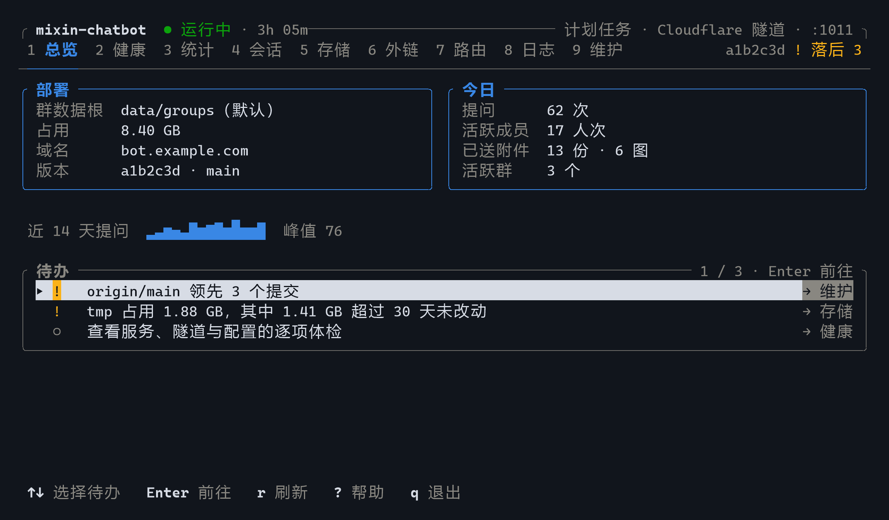
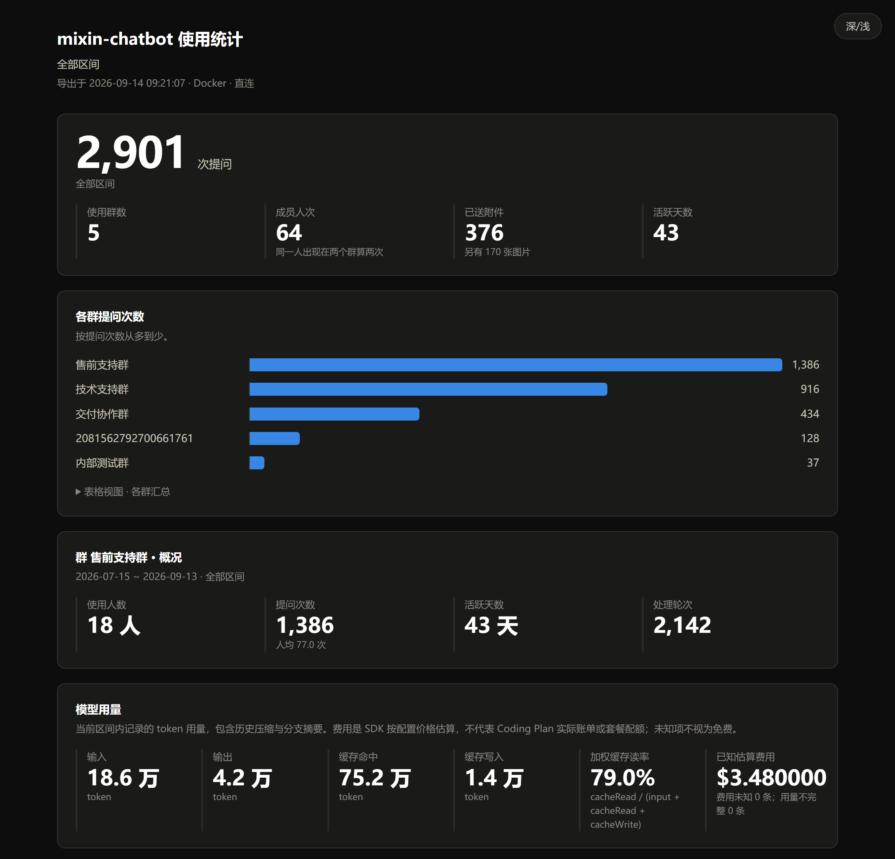

# 管理台与报表

[返回 README](../README.md) · [部署与配置](deployment.md) · [命令行运维](operations.md#命令行运维)

TUI 是在终端中操作的管理界面。启动后，用左右方向键切换分区，按空格查看当前页能执行的操作。

**本页内容**：[启动界面](#运维界面) · [五个主分区](#五个主分区) · [常用键位](#常用键位) · [设置入口](#设置入口) · [导出报表](#导出-html-报表) · [清理与维护](#清理与维护)

## 运维界面

一个终端集中查看服务状态、今日用量和待处理事项。用 **`←` `→` 切换主分区**，用 `Tab` 切换分区内的子页；选中待办后按 `Enter` 可直接进入对应功能。**空格打开当前页的操作菜单**，用方向键选择，也可以输入文字查找操作。

```sh
bun run tui
```

Windows 和 Linux 均在项目根目录运行。需要交互式终端和宿主机上的 [Bun 1.4.4+](https://bun.sh/docs/installation)，TUI 无需额外 npm 依赖。推荐终端尺寸 **100×24 或更大**，80×24 也可完整使用，最小支持 72×20；支持真彩色、256 色和 `NO_COLOR`。宽窗口并排显示操作与影响预览，窄窗口自动上下排列。

各页在进入时读取所需数据。总览的服务状态、今日用量、磁盘占用和版本信息会分别显示；切回已查看的页面时保留已有内容并更新。按 `r` 或从空格菜单刷新均在后台进行，慢查询期间仍可切页。加载动画持续更新；长查询、统计导出和打开报表的进度提示会保留到完成。系统页菜单立即显示，版本读取期间仅升级需要等待。

总览有待处理事项时只列这些事项，按严重度排序，表下一行提示其他功能所在的分区；没有时列出常用入口（临时文件、体检、日志、统计、服务部署）。机器人没有应答排在最前，回车进入“系统 → 服务部署”并选中“启动”；停止中和验证实例也会列出。机器人自本次启动以来停住或出错的任务、超时放弃的交付、未发出的模型请求和统计回退，最近一次在 24 小时内的列为待处理，回车进入日志；计数在机器人重启后清零，“监控 → 体检”的“运行状况”一行列出全部计数。

总览侧栏显示消息接收、运行版本、数据格式、本地代码和共享资料；运行方式和端口在页眉右上角。运行版本取自**正在运行的服务**，如“v1.0.0 · 3b7c8b2”（版本与构建）。服务未运行时取自部署记录并注明未运行；本地代码的程序版本或构建与运行中的服务不同时，另起一行“本地工具 v… · 运行服务 v…”。



*预览由实际 TUI 渲染生成，使用演示数据；示例为 Docker 部署，100×24 终端，截于总览改版之前：现版本有待处理事项时不再列出常用入口，侧栏不再重复运行方式和端口。*

> **Docker 部署**：机器人运行和命令行运维无需宿主机安装 Bun；使用 TUI 时，需在宿主机另装 Bun。外链配置向导复用部署镜像内的依赖。界面管理的是宿主机上的部署，可在机器人停止时启动。

### 五个主分区

| 主分区 | 包含功能 | 可以做什么 |
| --- | --- | --- |
| 总览 | 今日概况、待处理事项、常用入口 | 查看服务状态、事件 Stream 连接、用量与趋势，直接进入需要处理的功能 |
| 监控 | 体检、日志 | 查看故障与修复建议；搜索日志、筛选级别、按任务编号提取排查记录 |
| 统计 | 群与成员用量、报表 | 筛选群或成员，按日期查看用量、趋势和工具调用，导出 HTML 报表 |
| 数据 | 会话、临时文件、外链 | 查看全部成员和文件明细；清空一个会话空间（群或单聊）或全部空间的会话，预览清理范围并归档临时文件，修改外链配置，查看、测试和清理远端外链 |
| 系统 | 服务部署、通讯录、设置 | 启停、升级、重新部署、修复和卸载；查看 Stream 与通讯录同步、确认暂停的撤销；配置应用机器人、模型、外链和高级运行参数，查看辅助模型与 MCP 状态 |

切换主分区会记住上次查看的子页。常用的启动、重启、停止排在服务菜单前面；操作影响随选择立即展示，清理和卸载等操作仍需确认。服务菜单下方的图例说明各项的标记：✓ 不中断、● 短暂中断、! 停止服务、✗ 不可逆、○ 当前不需要；机器人在运行时“启动”标为 ○，没有应答时“停止”“重启”标为 ○（仍可执行，运维脚本会再核对一次）。总览的空格菜单只处理选中事项，切换分区用 `←` `→` 或数字键。

### 常用键位

底部提示会随当前页面和状态变化，常用操作如下：

| 按键 | 操作 |
| --- | --- |
| `←` `→` | 上一个 / 下一个主分区，首尾循环 |
| `Tab` / `Shift+Tab` | 当前分区的下一个 / 上一个子页 |
| `↑` `↓` / `j` `k` | 选择条目或滚动内容 |
| `Space` / `F2` | 当前页操作菜单；可输入文字筛选，再用方向键和回车操作 |
| `/` | 筛选群、成员或日志内容 |
| `Enter` / `Esc` | 进入或确认 / 返回或取消；列表中按 `Esc` 清除筛选 |
| `PgUp` / `PgDn`、`Home` / `End` | 翻阅长明细、检查结果与执行输出；执行面板按 `End` 恢复跟随 |
| `r` | 刷新当前状态 |
| `?` / `q` | 查看帮助 / 退出界面 |
| `1`–`5` | 直接进入五个主分区，作为备用快捷键 |

对话框打开时，方向键只操作对话框。日志按 `Home` 回到当前缓冲的最早记录，按 `End` 恢复跟随最新输出；搜索内容可与级别筛选叠加。按 `t` 查询任务时仍可翻阅日志，离开日志页会停止跟随轮询并取消未完成的任务查询。

### 清空会话

会话长期累积后，每位成员新一轮首次请求要写入的上下文越来越大。**数据 → 会话** 底部固定显示清空入口：

- `c` 清空当前空间（群或单聊）全部成员的会话：单聊空间输入“单聊”确认，群输入它的存储目录段确认（通常就是群号，不安全的群号编码为 `sha256-…`，以确认框显示的为准）；
- `a` 清空单聊和所有群，输入“全部清空”确认，不受列表筛选影响；某个空间失败时其余空间照常清空。

两者都相当于成员各自发送 `/clear`：自动停机登记并恢复原运行状态，机器人启动后先执行，排队中的消息一并取消。共享资料、临时文件、资料索引和未交付消息不受影响；使用统计保留已计入的数字，清空时的用量照常入账。

选中空间按 `Enter` 查看会话库占用和提问过的成员：名单取自使用统计，号码打码，最近提问的在前；会话库由运行中的机器人独占，界面不为名单去读它，所以不显示成员是否正在运行。用 `↑` `↓` 选中成员后按 `p` 登记压缩该成员的上下文，确认后停机登记并恢复原运行状态，机器人运行后生成摘要，会产生模型用量。从未提问的成员（以及账本里只有摘要形式身份的成员）在列表页按 `p` 输入号码。

### 通讯录

**系统 → 通讯录** 有四项：“查看 Stream 与同步状态”显示事件 Stream 是否连接、同步范围、通讯录映射数量、最近一次完整同步、正在进行的同步进度和待确认的撤销；“确认暂停的撤销”填写状态里显示的轮次，确认后服务立即重新完整扫描，缺席成员都在该轮名单内才撤销；“列出部门”按上级部门编号（留空为根部门）列出直属子部门的编号、人数和名称；“设置同步范围”填写部门编号（多个用逗号或空格分隔，留空为整个通讯录），服务先核对部门存在，再中止进行中的同步并按新范围重新扫描，范围外的成员按撤销规则处理；与现有范围相同时不改。总览会把 Stream 断开（超过 2 分钟标红）、暂停的撤销和不完整的同步列为待处理事项。规则见[事件 Stream 与通讯录](operations.md#事件-stream-与通讯录)。

### 设置入口

配置集中在 **系统 → 设置**：应用机器人、模型配置、辅助模型、MCP 工具、外链配置、高级运行参数。设置按选中项读取，等待时复用 TUI 的持续加载动画，仍可切换分类和页面。

模型配置项显示当前选用的 provider、模型和推理级别（该模型的单独设置优先于全局默认，超出模型支持范围时启动时自动下调）；回车先说明影响，确认后停止正在运行的机器人，运行与部署相同的配置向导（Docker 在部署镜像内运行），结束后恢复原运行状态。向导确认后才一起替换配置，取消或失败不修改。只换模型时用这里，不必重新部署；端口和共享资料目录仍在“重新部署”中修改。

应用机器人项显示是否已配置和平台环境（不显示凭据）；回车运行凭据向导，先用新凭据验证一次，确认后短暂停止机器人并替换，取消或失败不修改。换成另一个应用后通讯录随新应用重新同步，详见[应用机器人凭据](operations.md#应用机器人凭据)。换用其他 provider 后，若 `auxiliary.json` 引用的模型不再存在，启动检查会报错，需同步修改。

辅助模型与 MCP 工具为只读状态：显示是否启用、引用的分类 / 图片模型与并发预算，以及 MCP 服务器名称、传输、白名单工具数和是否使用 OAuth，不显示命令参数、环境变量或 URL；文件格式错误时显示原因。修改请编辑 `data/config/auxiliary.json`、`data/config/mcp.json` 后重启机器人，格式见[运行工具](runtime-tools.md)。

外链配置项显示当前桶、区域、端点、对象路径、链接有效期和单文件上限，不显示密钥；回车进入配置向导，**数据 → 外链 → 修改外链配置** 是同一个入口。改动云端权限或设置后，在 **数据 → 外链 → 测试外链** 上传测试文件验收，详见[测试外链](operations.md#测试外链)。

命令行帮助使用 `bun run tui --help`。管道、CI 和非交互环境使用[命令行运维](operations.md#命令行运维)。

### 导出 HTML 报表

在终端查看统计，在浏览器里阅读和分享：

1. 用 `←` `→` 进入统计，按 `w` 选择今天、昨天、本周、上周、本月、上月、近 7 天、近 30 天或全部；`d` 自定义起止日期，留空表示不限，`Esc` 保留原区间。列表按 `t` 查看所列群合计趋势，`g` 切换日、周、月；群明细也支持 `g`，所有日期均可滚动查看。
2. 查看各群和单聊（`direct`）的汇总，或选中一项按 `Enter` 查看成员、月度趋势和模型用量。
3. 按 `e` 导出，保存完成后按 `o` 用默认应用打开最近一份报表。保存路径持续显示在统计页顶部。

从旧版 webhook 发布切换过来时，在统计列表按 `i` 一次性导入旧版统计：逐级浏览目录（`..` 返回上一级，Windows 在盘符根目录再返回可换盘；也可选“输入路径…”），只列子目录和 `.sqlite`／`.sqlite3`／`.db` 文件，选中旧部署的 `data/groups/stats.sqlite`。确认页先只读预览将导入的提问数、成员日、token 和日期范围；已经导入过的同一份只提示、不运行，导入过另一份时说明原因并拒绝。确认后停机导入并恢复原运行状态，口径见[导入旧版统计](data-migrations.md#导入旧版统计)。

日期选择后在后台重读统计，期间仍可修改日期或切页，旧区间的迟到结果不会覆盖新选择。报表导出和打开浏览器也在后台完成，重复按键不会重复启动正在进行的同一操作。

概览显示总提问、跨群去重的提问人数、人均提问和提问最多的成员；完整日期范围显示提问与人数的同比、环比及基期日期。HTML 报表同时提供完整每日、每周、每月明细和成员排行，补充日均、活跃天数占比、提问高峰日、前五名提问占比，以及按模型、按工具和按入账日的 token 用量（不显示费用；token 按同步当天入账，见[统计账本](data-migrations.md#统计账本)）。趋势图最多显示最后 90 个周期，表格保留全部日期；无记录日期补 0，不能据此证明历史采集完整。按成员筛选仍是筛选其所在的群，统计整个所列群；比较也使用同一组群。未筛选时基期包含当时有记录、当前没有活动的群。

周从周一开始。本周、本月比较上一周期相同已到达日数，上月比较完整前月；其他自定义范围比较前一等长区间；同比取去年同日期，闰日截到月末。包含今天的区间尚未结束，对比不按小时对齐。基期为 0 不显示无限增长；全部或单边区间不计算同比环比。覆盖人数是实际提问人数，不是群总人数；首页的今日人数同样只计当天提问的成员，按身份跨群去重。



*图片为实际导出报表的上半部分，使用演示数据，截于旧版报表：现版本的用量区只显示 token，不显示费用。完整报表还包含趋势、成员和按模型、工具的用量，成员号码默认打码。*

报表保存到 `tmp/reports/`，每次导出生成独立文件。内容包含所选日期区间内、当前筛选列出的群汇总；从群明细导出时，还会附上该群明细。`/` 可按群名或成员查找，`Esc` 返回列表后再按一次可清除筛选。**单个 HTML 文件即可离线打开或转发**，支持深浅配色，图表配有可展开的数据表，无外部请求。报表保留导出时的统计快照，需要更新时重新导出。需要长期保存的报表请另行保留，旧 `backup/reports/` 中的文件不会自动移动或删除。

手机号默认打码。在群明细按 `m` 临时显号后，导出的报表仅该群明细包含完整号码；跨群汇总与排行始终打码。返回列表、切群或离开统计页会恢复打码，已导出的文件保留原内容。CLI 总览同样打码，指定群号的明细沿用完整号码。统计读取独立的使用统计账本，每次任务结束后即入账，清空或归档会话历史都不影响已入账的数字；每日趋势按消息发生的自然日计数，日期区间也按自然日裁剪。

### 清理与维护

在“数据 → 临时文件”按 `d` 打开天数选择菜单，预览命中的条目和字节数；`Enter` 查看该成员的全部文件及各项的“待归档 / 保留”状态。左右方向键始终用于切换主分区。`p` 只清理选中行对应的空间（群或单聊）与成员，`a` 处理所有空间（含单聊）的所有成员，**不受列表筛选影响**；同一成员在其他空间的内容不会被 `p` 清理。文件移入 `data/state/reclamation/backup/rm`，归档后磁盘空间尚未释放。按 `r` 预览并永久删除本工具归档、内容未变的条目，按 `x` 预览已登记产物的物理回收；两者显示可删除的条目数和字节数，输入“永久删除”后才执行。预览在服务运行时进行，只有确认执行时才停止服务并在结束后恢复原状态。

改动类操作先显示操作范围、步骤和恢复说明，卸载与全量清理还要求手动输入确认词。部署、升级、Linux 重建修复与卸载需要交互，界面会将终端交给运维脚本，结束后按回车返回；返回时状态在后台刷新，可以立即导航。维护执行期间按 Esc 会等待关键操作及恢复完成；日志等只读操作可以直接中止。退出界面会取消后台查询并回收查询进程，仍在执行的维护操作会完成收尾后退出。正在运行的界面不会自行重启：升级、继续或回滚改动了代码（不只是文档）时，系统页会提示，按 `q` 退出后重新运行 `bun run tui` 才会加载新版界面。

“重新部署”运行当前代码，重新确认共享资料目录和模型；本机端口沿用，改端口见[本机管理端口](deployment.md#本机管理端口)。选中“升级”后会在后台拉取 `origin/main`，显示本次检查的当前提交、目标提交和待应用列表；检查完成后按 Enter 确认，等待期间仍可切换操作或页面。检查失败时按 `r` 重试；重新选中升级也会检查远端。预览只更新远端引用，不改本地代码或重启服务，确认执行后才进入升级流程，并再次核对远端。新机器需先安装 Bun 及平台部署所需的环境，再运行平台部署脚本完成初始化；已有部署可从“系统 → 服务部署”重新部署。TUI 的升级调用与命令行 `ops update` 相同的目标升级器，并保留交互终端供确认和配置。升级按部署记录判断：数据格式一致时直接升级；没有部署记录的空目录提供部署；基础版本字段有效、只是数据格式不受当前代码支持时提供“升级（检查数据格式）”，由目标版本的升级器判断能否接手（应用绑定也由目标版本校验）；有运行数据却没有部署记录、记录损坏或缺字段（含没有程序版本的旧版 webhook 数据）时只提供诊断，不重置、不清理，提示在新目录全新部署（旧版 webhook 发布的切换见[版本、数据格式与从旧版切换](data-migrations.md)）。停止服务后的统计核对、提交与回滚均共用 CLI 流程。代码已最新也会检查部署记录；记录与代码不匹配时进入升级 / 诊断恢复菜单。继续及回滚共用同一事务，提交后只能继续收尾。模型配置重建见[运维手册](operations.md#重新配置模型)。

界面读取宿主机上的部署数据，维护操作复用 `ops.sh` / `ops.ps1`。“监控 → 体检”复用 `doctor --json`（Windows 为 `doctor -Json`）的逐项结果；等待体检期间仍可进入修复确认。有失败项时，JSON 接口返回非零退出码。部署、升级、修复等操作结束后，旧体检结果和在途查询会失效；回到体检页时重新检查，迟到的旧结果不会覆盖新状态。

TUI 内的诊断建议和部署结果会指向实际菜单路径，例如“系统 → 通讯录”或“监控 → 日志”。开发者后台、配置文件和系统权限仍按具体说明处理；直接调用运维脚本时保留命令行指引。
