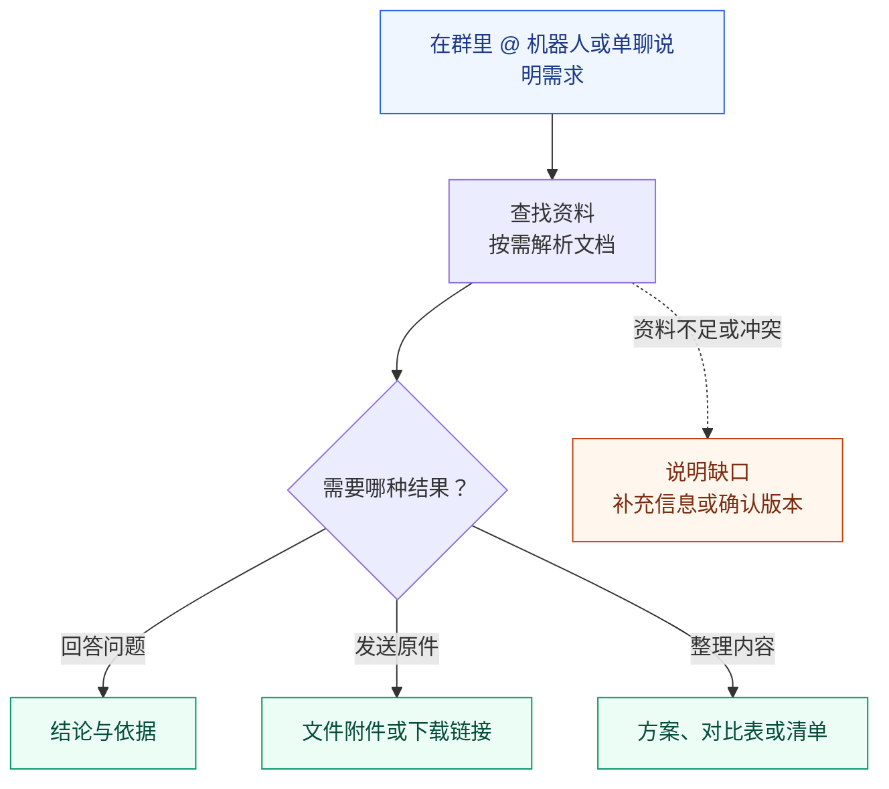
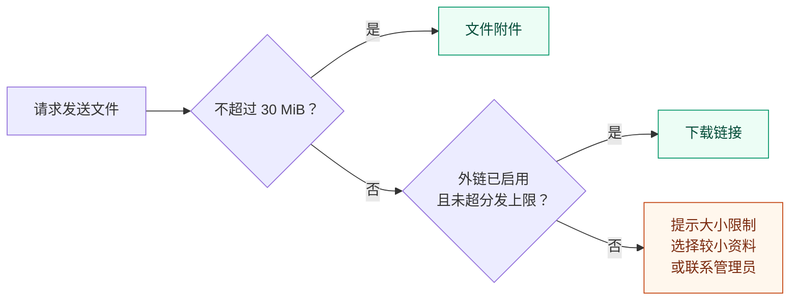

# 使用指南

[返回 README](../README.md) · [部署与配置](deployment.md) · [故障排查](operations.md)

在群里 @ 机器人并说明需求，或直接和机器人单聊。本文介绍怎么提问、控制任务、发送和接收文件。

**本页内容**：[使用示例](#使用示例) · [群聊与单聊](#群聊与单聊) · [使用流程](#使用流程) · [指令](#指令) · [发给机器人的文件](#发给机器人的文件) · [文件交付](#文件交付)

## 使用示例

以下是自带提示词（产品资料助手）下的典型用法。把示例中的产品或项目名称替换为实际名称，在群里说明你要什么结果。

| 想做什么 | 可以这样问 | 预期结果 |
| --- | --- | --- |
| 📚 查产品信息 | “X 产品支持哪些部署方式？请注明资料来源。” | 结论与文件依据；资料缺失时说明缺口 |
| 📎 拿原始资料 | “把 X 产品当前正式版的手册原文件发给我。” | 原始文件附件，或配置了外链后的下载链接 |
| 📊 做资料对比 | “对比 X 和 Y 的功能、部署方式及限制，生成 Excel 表。” | 对比文件，并标明依据或缺失项 |
| 📝 整理交付物 | “根据资料整理项目 A 的方案，生成 Word 文件，列出待确认项。” | 方案文件与待确认事项 |
| 📄 修改底稿 | “以现有交付方案为底稿，按最新正式资料更新部署条件，保留原版式。” | 修改后的 Word 副本 |
| 🖥️ 选编方案 | “从产品介绍 PPT 中挑选与客户需求相关的页面，补充部署建议，组装客户方案。” | 可编辑 PPT 与主要来源说明 |

说明用途、版本要求和输出格式，有助于缩小检索范围。每位用户在每个群和单聊中有独立会话，引用“上一份文件”时要保证它出现在你与机器人的当前对话中。

## 群聊与单聊

| | 群聊 | 单聊 |
| --- | --- | --- |
| 怎么提问 | 必须 @ 机器人，否则机器人收不到 | 直接发送 |
| 资料来源 | 共享资料目录（与单聊相同） | 共享资料目录（与群聊相同） |
| 回复格式 | 回复开头有一行“> 回复 姓名：提问摘要”，标明回复的是谁的哪条提问；最终结果和终止性错误会 @ 提问人。较长的回复分成几条连续发出，只有第一条带摘要和 @，中间不会夹入机器人发给别人的消息（群成员此时发的消息仍可能出现在中间） | 直接回复 |
| 发文件给机器人 | 不支持，请在单聊中发送 | 支持图片、文件和视频，见[发给机器人的文件](#发给机器人的文件) |

机器人按通讯录识别成员（以手机号归属会话和统计）。刚部署或你刚加入通讯录时，可能收到“正在同步通讯录”或“暂时无法确认身份”的提示，稍后重发即可；一直如此请联系管理员核对应用的通讯录可见范围。文字、引用回复以外的消息类型（如语音）暂不支持。

服务重启或升级期间发出的消息，平台约 5 分钟后补推，机器人收到后照常处理，第一条回复会注明“这条消息约 N 分钟前发出”；停机超过 5 分钟时，期间的消息可能收不到，需要重发。补推到达的 `/stop`、`/clear`、`/compact` 不会执行，以免影响之后的任务，需要时请重发。

### 文档怎么提需求

三种方式都可以直接用自然语言提出：修改现有 Word；从已有 PPT 选页、改页并组装；在产品资料和模板的版式上生成新文档。说明目标读者、底稿或模板、需要解决的问题即可，不需要指定工具调用顺序。例如：“给客户 IT 负责人看，以现有部署方案为底稿，复用正式产品介绍中的架构图，补充实施与验收部分，输出 Word 和 PPT。”

指定模板会让新内容沿用它的母版、字体和页眉页脚，例如“用产品介绍 PPT 的版式，保留它的封面和封底”。没有指定时机器人会从资料中选择合适的样例文件，或使用默认版式。

也可以继续说“把刚才方案中的实施安排改成分两期，其他内容保留”，或“在处置流程那页加一张带判断分支和回退的流程图”。机器人在用户临时目录生成副本，后续编辑沿用最近成品。售前方案、交付计划和售后问题报告共用文档能力，章节结构根据任务选择。

文件预览需要部署环境支持；模型会用图片检查版式。没有成功预览或模型不能看图时，应明确说明未完成视觉检查。重要客户交付还需用实际 Office 和目标字体核对；来源母版、页眉页脚及复杂对象的具体限制见[文档加工说明](development.md#能力边界)。

## 使用流程

机器人依据共享资料目录中的资料工作，价格、参数和政策需要资料支持。版本以正式发布、生效信息为准；资料不够或存在冲突时，应先说明并确认，不能靠历史答案补齐。

同一用户连续发来的请求会排队执行。等待期间可以用 `/status` 查看进度，用 `/stop` 取消，或用 `/clear` 开始新会话。

如果清理暂时受文件占用或权限问题阻挡，机器人会说明正在自动重试；清理完成前，新消息继续排队。可用 `/status` 查看最近错误，完成后队列会自动继续。

## 指令

群聊中指令同样需要 @ 机器人。

| 输入 | 行为 |
| --- | --- |
| 普通消息 | 同一会话顺序执行，最多 8 条等待消息 |
| `/stop` | 立即取消当前任务并清空等待消息，回执发送不阻塞停止；之后发来的消息在停止完成后执行 |
| `/clear` | 取消并等待收尾，为本人在当前群或单聊开启新会话（旧会话留在库里）；后续消息在清理完成后执行 |
| `/compact` | 主动生成上下文摘要并保留历史记录，会产生模型用量；失败保留原上下文，可用 `/stop` 取消 |
| `/status` | 查看处理进度、等待消息、正在运行的工具和待处理附件；任务因服务反复异常中断被停放时显示“已停放”，发送 `/stop` 或 `/clear` 后可继续对话 |
| `/help` | 查看指令说明 |

`/clear` 只影响你在当前群或单聊的对话，不清除其他人的会话。`/stop` 会丢弃排队中的请求；需要继续处理时请重新发送，已发送的消息无法撤回。`/stop` 和 `/clear` 也会停止你之前还没发完的回复和文件的自动重发。

机器人收到的消息先存进库里再处理，服务重启也不会丢；重启前没处理完的消息，以及已开始执行的 `/stop`、`/clear`，会在重启后接着处理，回复仍发回原来的群或单聊。同一条消息被平台重复推送时只处理一次。

脚本保存的结果在当前模型上下文或还没发完的回复引用时继续保留，引用释放后才按保留期清理。不要手工删除这些文件，否则已保存的引用可能无法打开。

## 发给机器人的文件

在单聊中把图片、文件或视频发给机器人，它会回复“已收到…，请说明要怎么处理”，并在后台下载；接着发一条文字说明要做什么（例如“总结这份文件”）。这条请求会带上它之前收到、还没用过的所有附件，执行前最多等待下载 2 分钟。

- 项目不限制收取的文件大小，以平台和服务器磁盘为准；下载失败（平台拒绝、超时、磁盘不足）时会在回复中说明原因。
- 每人最多保留 10 个还没用过的附件；发出后 24 小时内没有被请求用到的会作废。
- `/stop`、`/clear` 取消的请求，其附件随之作废；`/clear` 同时作废之前还没用过的附件。
- 模型支持图像时，机器人可以直接查看图片。

## 文件交付

发送本地文件时，系统按大小和已配置的能力选择交付方式：

不超过 **30 MiB** 的文件以平台文件消息直接发送；更大的文件需要管理员配置可选的外链，外链默认上限为 **2 GiB**。外链从私有对象存储直接下载，默认有效 **2 小时**，到期后额外保留 **30 分钟**再清理文件；删除余量不延长下载授权。请在消息所示期限内下载，具体规则见[大文件外链配置](deployment.md#大文件外链配置)。

> **回复、文件或下载链接没有发出去时**，机器人会自动重发：第一次约 1 分钟后，之后间隔逐步拉长（5、15、30 分钟，以后每小时），从生成起 6 小时内仍未发出就放弃；任务失败时的兜底内容只在兜底发送时限内重试。服务重启后照常接着重发，已经确认送达的部分不会再发。只有平台明确拒收的内容才重发；发送结果不确定（平台可能已收到但应答丢失）的内容视为已发，不再重发，以免重复。下载链接过期、文件已被删除这类重发也解决不了的问题不再重试。

“文件生成成功”或“链接生成成功”与会话里确认收到是不同的步骤。
